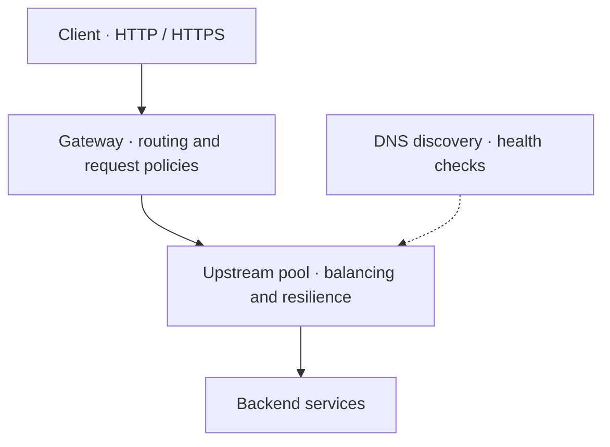

<p align="center">
  
</p>

<h1 align="center">DevGate</h1>

<p align="center">
  <strong>Route. Protect. Observe.</strong><br>
  A Go API gateway built for reliable HTTP traffic.
</p>

<p align="center">
  <a href="https://github.com/chyioIshi/DevGate/actions/workflows/ci.yml"></a>
  <a href="go.mod"></a>
  <a href="LICENSE"></a>
</p>

<p align="center">
  <a href="#quick-start">Quick start</a> &nbsp;·&nbsp;
  <a href="#architecture">Architecture</a> &nbsp;·&nbsp;
  <a href="#observability">Observability</a> &nbsp;·&nbsp;
  <a href="docs/configuration.md">Configuration</a> &nbsp;·&nbsp;
  <a href="#testing-and-quality">Tests</a>
</p>

---

DevGate sits between clients and backend services. It routes requests, applies
authentication and traffic policies, and forwards traffic to eligible upstream
endpoints without buffering entire request or response bodies.

The design emphasizes predictable behavior when dependencies fail, endpoints
change during active requests, or clients keep streaming connections open.

## Capabilities

- **Routing:** segment-aware path prefixes, exact paths, HTTP methods, hosts,
  exact header conditions, and explicit priorities. Ambiguous routes fail startup.
- **HTTP proxying:** streamed bodies, request and response trailers, WebSocket
  upgrades, path-prefix stripping, and request/response header transformations.
- **Upstream management:** static pools or periodic DNS discovery, with
  round-robin, random, and least-requests balancing.
- **Resilience:** bounded retries with exponential backoff and jitter,
  per-route circuit breakers, active probes, and passive endpoint ejection.
- **Traffic policies:** local or Redis-backed token buckets, per-route request
  timeouts, and streaming request-body limits.
- **Security:** route-level API keys, optional TLS termination with a TLS 1.2
  minimum and HTTP/2 negotiation, and CIDR-based forwarding-header trust.
- **Observability:** Prometheus metrics, structured text/JSON logs, request IDs,
  and a health endpoint.
- **Route actions:** proxy to an upstream, return a static response, or redirect;
  customize gateway-generated errors without rewriting upstream responses.

## Quick start

**Requirements:** Go **1.26.3 or newer**, Python 3 for the demo backend, and
`curl`. Redis is optional and is not needed for this demo.

Clone the repository:

```bash
git clone https://github.com/chyioIshi/DevGate.git
cd DevGate
```

### 1. Start a local backend

From the repository root, serve the included demo response:

```bash
python3 -m http.server 9000 --bind 127.0.0.1 --directory examples/backend
```

Python is only a convenient demo server; DevGate itself is a Go binary.

### 2. Start DevGate

In a second terminal, from the repository root:

```bash
go build -o bin/devgate ./cmd/devgate

DEVGATE_HTTP_ADDR=127.0.0.1:8080 \
DEVGATE_CONFIG_FILE=examples/local.yaml \
DEVGATE_LOG_FORMAT=json \
./bin/devgate
```

The ready-to-run [local configuration](examples/local.yaml) needs no external
services beyond the demo backend.

### 3. Send traffic

In a third terminal:

```bash
curl -i http://127.0.0.1:8080/api/hello.txt
```

Expect `200 OK`, an `X-Request-ID` response header, and:

```text
Hello from upstream
```

DevGate matches `/api`, strips that prefix, and forwards `/hello.txt` to the
backend. Try the operational endpoints and an unmatched route:

```bash
curl -i http://127.0.0.1:8080/healthz
curl -sS http://127.0.0.1:8080/metrics
curl -i http://127.0.0.1:8080/not-a-route
```

`/healthz` returns `200` with `ok`; `/metrics` exposes Prometheus metrics;
the unmatched route returns `404`.

Stop both servers with `Ctrl+C`. Both bind only to loopback; the backend serves
only `examples/backend`. See the [failure walkthrough](docs/demo.md) to observe
upstream failures and circuit-breaker recovery.

## Architecture

DevGate validates configuration at startup and builds an immutable routing
table. Background discovery and health checks update upstream eligibility
independently of request handling.



Routes can also return direct responses or redirects without selecting an
upstream. See [architecture and code map](docs/architecture.md) for the full
request path, package boundaries, and transport ordering.

## Engineering decisions

- **Streaming-aware load:** least-requests accounting includes the lifetime of
  response streams and WebSocket connections, not just response headers.
- **Consistent discovery:** complete endpoint snapshots coordinate membership,
  health, and balancing; removed endpoints may finish in-flight requests.
- **Bounded retries:** only bodyless `GET` / `HEAD` transport failures are
  retried on the selected endpoint. Health accounting sees the final result.
- **Explicit failure policy:** no eligible upstream or a Redis limiter error
  returns `503`; exhausted rate-limit capacity returns `429`.
- **Explicit trust boundaries:** forwarding headers require trusted proxy CIDRs;
  authenticated API-key headers are removed before forwarding.

Read the [design rationale and supporting tests](docs/architecture.md#engineering-decisions).

## Observability

With JSON logging enabled, a successful demo request produces a structured
completion record. Example captured from the local demo, with timestamp and
duration omitted:

```json
{
  "level": "INFO",
  "msg": "request completed",
  "method": "GET",
  "path": "/api/hello.txt",
  "route": "demo",
  "request_id": "c44533b1d5d6606a4bdc48cf40592b90",
  "status": 200,
  "bytes": 20
}
```

The request ID matches the `X-Request-ID` response header. After that request,
`/metrics` includes:

```text
devgate_http_requests_total{route="demo",status="200"} 1
```

HTTP metrics also expose request-duration histograms and an in-flight gauge.
Request IDs stay in logs and headers, not metric labels.

## Configuration and operations

- **Route policies:** strict YAML; the default path is `devgate.yaml`.
  Override it with `DEVGATE_CONFIG_FILE`.
- **Process settings:** `DEVGATE_` environment variables.
  [`.env.example`](.env.example) lists settings; `.env` files are **not**
  automatically loaded.
- **Secrets:** provide API-key values and Redis passwords through the deployment
  environment. TLS certificates and private keys are loaded from configured files.
- **Health:** `/healthz` is process liveness, not a guarantee that upstreams or
  Redis are available.
- **Metrics:** `/metrics` exposes HTTP volume, latency, in-flight requests,
  authentication, rate limiting, circuit-breaker, health, and discovery metrics.
- **Shutdown:** `SIGINT` / `SIGTERM` initiate bounded HTTP shutdown; background
  discovery and health workers have cancellation and a wait path.

The health and metrics endpoints share the gateway listener and are outside
route-level authentication. Restrict access at the network or reverse-proxy
boundary when deploying.

See the [configuration guide](docs/configuration.md) for policy semantics,
YAML examples, TLS, Redis settings, and trusted-proxy configuration.

## Testing and quality

The [CI workflow](.github/workflows/ci.yml) checks formatting, runs `go vet`,
executes the test suite with the race detector, builds the binary, and runs
`golangci-lint`.

Run the main checks locally:

```bash
go test -race ./...
go vet ./...
golangci-lint run ./...
go build -o bin/devgate ./cmd/devgate
git diff --check
```

Tests include local-listener and `httptest` scenarios for streaming, trailers,
WebSockets, TLS, endpoint removal, DNS changes, and failure policies. Redis
limiter tests use an in-process Redis test server; the suite does not require
an external Redis instance.

Router and load-balancer microbenchmarks report time and allocations:

```bash
go test -run '^$' -bench . -benchmem ./internal/router ./internal/upstream
```

These measure individual hot paths, not end-to-end gateway throughput.
No production capacity claim is inferred from them.

## Current scope and limitations

- The implemented data plane is HTTP. A `grpc` route protocol is not yet
  supported; HTTP/2 TLS negotiation alone does not imply gRPC support.
- Route configuration and API-key credentials are loaded at startup; changing
  them requires a restart. DNS endpoint refresh is dynamic.
- Rate limits are per route, not per client or authenticated identity.
- DNS discovery currently supports HTTP targets only; static pools also accept
  HTTPS endpoints.
- Authentication currently uses API keys; there is no JWT/OIDC integration.
- This repository does not yet provide an end-to-end capacity study or an
  audited security assessment. Deployment-specific hardening remains necessary.

## License

[MIT](LICENSE)
