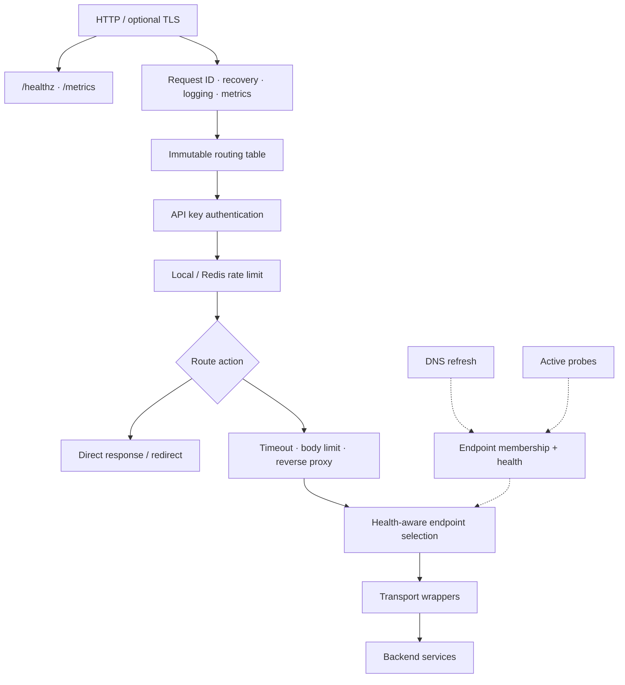

# Architecture

[Back to README](../README.md)

DevGate's composition root builds validated routing and policy objects at
startup. The routing table is immutable during request handling. DNS discovery,
endpoint health, and load-balancing state can change without reloading routes.

## Request path



Policy stages apply only when configured. The diagram follows the request
direction; response handling unwinds through the wrappers. Operational
endpoints bypass route-level authentication and policies.

For upstream routes, the outgoing transport call order is:

```text
release wrapper
  → route circuit breaker
    → passive health observer (when configured)
      → retry transport
        → shared HTTP transport
```

Endpoint selection happens before this chain. Retries reuse the selected
endpoint. Active health probes use the underlying HTTP transport directly.

## Code map

- [`cmd/devgate`](../cmd/devgate): configuration mapping, dependency wiring,
  server lifecycle, and background-worker ownership.
- [`internal/config`](../internal/config) →
  [`internal/router`](../internal/router): strict external configuration mapped
  into validated routing-domain objects.
- [`internal/gateway`](../internal/gateway): dispatch, request logging, recovery,
  and HTTP metrics.
- [`internal/proxy`](../internal/proxy): reverse proxy, transport wrappers,
  retries, circuit breaking, and forwarding-header trust.
- [`internal/upstream`](../internal/upstream) +
  [`internal/discovery`](../internal/discovery): endpoint selection, membership,
  health state, and DNS snapshots.
- [`internal/apikey`](../internal/apikey),
  [`internal/ratelimit`](../internal/ratelimit), and focused HTTP middleware
  packages: independently testable request policies.
- [`internal/metrics`](../internal/metrics): Prometheus adapters for policy and
  upstream observers.

The executable owns shared dependencies and their cleanup. Packages receive
dependencies explicitly instead of creating hidden global clients or workers.
Background discovery and health workers have a cancellation and wait path.

## Engineering decisions

### Streaming is a lifecycle concern

The proxy uses Go's `net/http/httputil.ReverseProxy` rather than pre-reading
bodies. Endpoint acquisition has an idempotent release path, and least-requests
balancing tracks load through response-body closure, not just response headers.
A slow stream or WebSocket connection therefore remains part of endpoint load.

This avoids hiding long-lived requests from the balancing policy and preserves
streaming rather than trading protocol behavior for simpler accounting.

See [proxy protocol tests](../internal/proxy/proxy_test.go),
[release-wrapper tests](../internal/proxy/releasing_transport_test.go), and
[WebSocket integration tests](../cmd/devgate/websocket_integration_test.go).

### Discovery publishes complete endpoint snapshots

DNS refresh coordinates membership, health state, and balancing. Removed
endpoints receive no new requests while in-flight requests may finish.
A failed lookup retains the last successful snapshot; a successful empty
answer removes all endpoints. With no eligible endpoint, the route returns
`503` instead of sending traffic to a known-unavailable backend.

Retaining the last successful snapshot avoids discarding usable endpoints
because of a transient resolver failure. A successful empty result is
treated differently: it is a membership update, not a lookup failure.

See [endpoint coordination](../internal/upstream/endpoint_coordinator.go) and
[DNS integration tests](../cmd/devgate/dns_discovery_test.go).

### Retries and health accounting have deliberate boundaries

Retries apply only to bodyless `GET` and `HEAD` requests that encounter a
transport error, not to HTTP `5xx` responses. They reuse the selected endpoint;
they are not cross-endpoint failover. Backoff honors request cancellation.

The route circuit breaker wraps passive health, which wraps retries. Both
health accounting and circuit breaking observe the final transport result
rather than counting every retry as a separate failed request. Circuit
rejections do not penalize an endpoint, and active probes bypass both wrappers.

This conservative retry policy avoids replaying request bodies or treating
potentially non-idempotent operations as safe to repeat. Wrapper ordering keeps
retry attempts from artificially accelerating endpoint ejection.

See [retry policy](../internal/proxy/retry.go),
[circuit-breaker tests](../internal/proxy/circuit_breaker_test.go), and
[transport wiring](../cmd/devgate/handlers.go).

### Distributed limits have an explicit failure policy

Local buckets are independent per process. Redis-backed buckets share one
per-route limit across replicas using an atomic Lua script and Redis server
time. Exhausted capacity returns `429`; a Redis runtime error fails closed
with `503`. Automatic Redis command retries are disabled to avoid consuming
tokens twice after an ambiguous network failure.

Fail-closed behavior protects the upstream limit at the cost of availability
when Redis is unavailable. It is not an automatic fallback to independent local
buckets, which would silently change the distributed limit.

See [Redis limiter](../internal/ratelimit/redis.go),
[limiter tests](../internal/ratelimit/redis_test.go), and
[Redis client configuration](../cmd/devgate/redis.go).

### Trust and identity are explicit

Forwarding chains are not trusted by default. Only configured proxy CIDRs may
contribute a chain, and spoofed values before the client trust boundary are
discarded. API-key secrets come from environment variables, are compared using
constant-time digest comparisons, and are removed from requests before later
middleware and upstream forwarding. Credential names and secrets are not
authentication metric labels.

The authenticated identity is carried in the request context, not inferred
from a client-supplied identity header. Rate limits currently remain per route,
not per authenticated identity.

See [trusted-proxy policy](../internal/proxy/trusted_proxies.go),
[API-key middleware](../internal/apikey/middleware.go), and
[identity propagation tests](../cmd/devgate/api_key_test.go).
